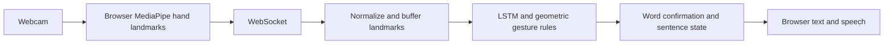

# SignBridge AI

**Real-time sign-language recognition demonstration · 25BTRAD051**

SignBridge captures hand landmarks in the browser and streams them to a FastAPI server. The backend combines a PyTorch LSTM model with geometric gesture rules, stabilizes predictions into words, and returns text. Browser speech synthesis and a server-side speech endpoint provide audio output.



## Setup and running

Use 64-bit Python 3.11 or 3.12. Run the following in **this application folder**, not the repository root:

```powershell
python -m venv .venv
.\.venv\Scripts\python.exe -m pip install --upgrade pip
.\.venv\Scripts\python.exe -m pip install torch --index-url https://download.pytorch.org/whl/cpu
.\.venv\Scripts\python.exe -m pip install -r .\backend\requirements.txt
.\start.bat
```

CPU installation does not require an NVIDIA GPU. For other builds, use the [official PyTorch installer](https://pytorch.org/get-started/locally/). See also [MediaPipe's Python setup guide](https://developers.google.com/edge/mediapipe/solutions/setup_python).

The Windows launchers use `.venv\Scripts\python.exe` and resolve paths relative to their own location. They do not install packages or train a missing model automatically. To launch manually:

```powershell
.\.venv\Scripts\python.exe -m uvicorn backend.main:app --host 127.0.0.1 --port 8000
```

Open [localhost:8000](http://localhost:8000), allow camera access, and start the camera from the page. The frontend downloads MediaPipe assets from jsDelivr, so it is not fully offline. Remote deployment requires HTTPS for camera access and additional deployment configuration.

## Included files

```text
backend/                 FastAPI, prediction, preprocessing, and sentence logic
  hand_landmarker.task   MediaPipe model asset
  requirements.txt       Python dependencies, including PyTorch
frontend/                HTML, CSS, and browser JavaScript
model/
  trained_model.pt       Saved LSTM checkpoint
  labels.json            20 vocabulary labels
  confusion_matrix.png   Existing evaluation figure
  train_model.py         Training and held-out split generation
  evaluate_model.py      Evaluation and confusion matrix
  dataset_collector.py   Synthetic data generation and live recording
dataset/                 Compressed data and extraction guide
test_accuracy.py         Synthetic gesture diagnostic
start.bat                Windows server launcher
train.bat                Windows training and evaluation launcher
```

Raw and processed dataset directories are **not extracted in a fresh clone**. Follow the [dataset guide](dataset/README.md) before training or evaluating saved data. They are not needed to serve the included checkpoint.

## Vocabulary

[model/labels.json](model/labels.json) contains `HELLO`, `NAMASTE`, `THANK YOU`, `PLEASE`, `YES`, `NO`, `HELP`, `HOW`, `ARE`, `YOU`, `GOOD`, `BAD`, `LOVE`, `PEACE`, `STOP`, `OK`, `SORRY`, `WATER`, `WELCOME`, and `NEUTRAL`.

NEUTRAL is an idle class. This is a demonstration vocabulary, not complete Indian Sign Language coverage. Geometry rules and synthetic examples may not represent natural signing across users, camera positions, and lighting conditions.

## Training and evaluation

Training replaces `model/trained_model.pt` and can update processed data. Back up the checkpoint before experimenting.

```powershell
# Train with the default 40 epochs and batch size 32, then evaluate
.\train.bat

# Override training options
.\train.bat --epochs 60 --batch_size 32 --patience 15

# Evaluate a saved checkpoint after preparing the dataset
.\.venv\Scripts\python.exe .\model\evaluate_model.py

# Print predictions for synthetic landmark examples
.\.venv\Scripts\python.exe .\test_accuracy.py

# Record a gesture using the webcam
.\.venv\Scripts\python.exe .\model\dataset_collector.py --live --gesture HELLO
```

`test_accuracy.py` is a diagnostic, not an automated accuracy assertion suite. The training loader generates synthetic data when compatible processed data is absent. Evaluation prefers `X_test.npy` and `y_test.npy`; its fallback uses the full processed dataset. That fallback is **not a held-out accuracy measurement**.

The saved [confusion matrix](model/confusion_matrix.png) is a historical project artifact. It was not re-evaluated during repository cleanup. Synthetic-data results should not be presented as validated webcam performance.

## Server endpoints

| Method | Path | Purpose |
| --- | --- | --- |
| GET | `/api/status` | Service status, model readiness, load errors, and vocabulary |
| GET | `/api/vocabulary` | Gesture vocabulary and descriptions |
| POST | `/api/speak` | Server-side text to speech |
| POST | `/api/model/reload` | Reload the saved model |
| WebSocket | `/ws/landmarks` | Landmark input, predictions, and confirmed words |

The landmark protocol uses `type: "landmarks"`, `left_hand`, `right_hand`, and `client_timestamp`. A detected hand contains 21 objects with `x`, `y`, and `z` coordinates; an absent hand is `null`. [frontend/script.js](frontend/script.js) implements the protocol and sentence controls.

## Troubleshooting

| Symptom | Check |
| --- | --- |
| Missing environment | Create `.venv` inside this folder and install the requirements |
| `model_loaded` is false | Read `model_error` at `/api/status`; check dependencies and checkpoint |
| Camera is blocked | Allow permission, use localhost, and close other apps using the camera |
| Browser tracking fails | Check access to jsDelivr and inspect the browser console |
| Evaluation cannot find `.npy` files | Follow the [dataset guide](dataset/README.md) |
| Port 8000 is in use | Stop the other server or use a different `--port` in the manual command |
| Speech is silent | Check browser/system voices and audio output |

[Back to the repository guide](../README.md)
