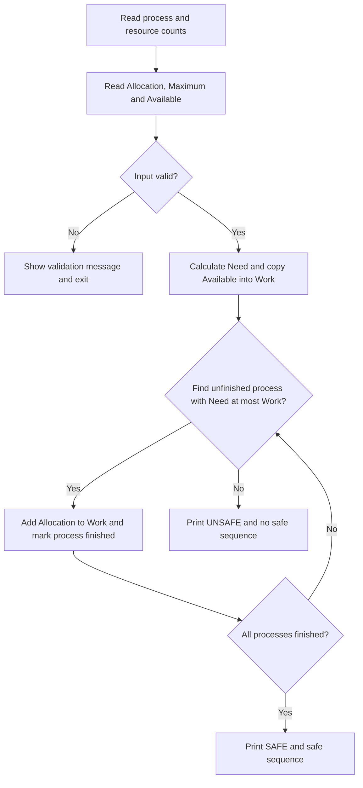

# Deadlock in a Hospital Resource Management System

This Java console application implements the educational simulation described in the [Operating Systems report](docs/Hospital_Deadlock_Report_25BTRAD051.docx). It reads resource-allocation data, calculates the remaining Need matrix, and applies Banker's safety algorithm to find a completion sequence or report an unsafe state.

| Submission detail | Value |
| --- | --- |
| Student | Kaviya Dharshini |
| USN | **25BTRAD051** |
| University | Jain University |
| Programme | Artificial Intelligence and Data Engineering, Semester III |
| Course | Operating Systems |
| Faculty | Mrs. Shanti B. Hegde |
| Academic year | 2026–2027 |

## Hospital scenario

Processes represent hospital software services such as patient records, billing, laboratory reporting, and appointments. Resource types can represent database connections, storage slots, and printers. Process and resource indices are generic; the program accepts any resource count within its documented input limits.

The model is a fixed snapshot. Each process declares its maximum demand in advance, and reusable resources are released after simulated completion. It does not connect to a hospital or control clinical equipment.

## Requirements

- JDK 11 or newer, including both `java` and `javac`.
- Windows PowerShell 5.1 or newer for the supplied Windows scripts. Direct Java commands also work on Linux.
- No external libraries, Python environment, database, web server, or model download is required.

The Windows scripts look for a JDK in `JAVA_HOME`, then `PATH`, then the current user's `.jdks` directory. They use the compiler and Java runtime from the same JDK.

## Run on Windows

Open PowerShell in this project folder.

```powershell
# Interactive entry of all matrices
powershell.exe -NoProfile -ExecutionPolicy Bypass -File .\run.ps1

# Report example with the resource-release trace
powershell.exe -NoProfile -ExecutionPolicy Bypass -File .\run.ps1 -InputFile .\samples\safe.txt -Trace

# Unsafe snapshot
powershell.exe -NoProfile -ExecutionPolicy Bypass -File .\run.ps1 -InputFile .\samples\unsafe.txt -Trace

# Automated regression checks
powershell.exe -NoProfile -ExecutionPolicy Bypass -File .\test.ps1
```

Alternatively, double-click `start.bat` for interactive use. The script compiles into the ignored `build` directory before launching. When using `-InputFile`, relative paths are resolved from your terminal's current directory.

## Compile directly on Windows or Linux

From the project folder, run:

```text
javac HospitalDeadlock.java
java HospitalDeadlock
java HospitalDeadlock --input samples/safe.txt --trace
java HospitalDeadlock --help
```

The source filename and public class are both `HospitalDeadlock`, as specified in the report. Direct compilation creates `HospitalDeadlock.class`, which Git ignores.

## Input format

Supply whitespace-separated integers in this order:

1. Number of processes `n`.
2. Number of resource types `m`.
3. Allocation matrix: `n` rows, each with `m` values.
4. Maximum Demand matrix: `n` rows, each with `m` values.
5. Available vector: `m` values.

Newlines help readability; the parser treats all whitespace equally. Do not include comments or labels in input files. Interactive mode completes after the Available vector, without needing an EOF keystroke. File mode rejects surplus tokens after a complete snapshot.

For the report example, resources A, B, and C mean Database, Storage, and Printer:

| Process | Allocation A B C | Maximum A B C | Need A B C |
| --- | --- | --- | --- |
| P0 | 0 1 0 | 7 5 3 | 7 4 3 |
| P1 | 2 0 0 | 3 2 2 | 1 2 2 |
| P2 | 3 0 2 | 9 0 2 | 6 0 0 |
| P3 | 2 1 1 | 2 2 2 | 0 1 1 |
| P4 | 0 0 2 | 4 3 3 | 4 3 1 |

Available starts as `[3, 3, 2]`. The corresponding input is in [samples/safe.txt](samples/safe.txt).

## How the safety check works

`Need[i][j] = Maximum[i][j] - Allocation[i][j]`

Copy Available into Work and mark every process unfinished. Scan processes in increasing index order. Select a process only when its Need is no greater than Work for **every** resource type. Simulate completion by adding that process's Allocation to Work. Continue scanning, then repeat until all processes finish or an entire scan makes no progress.



For the report example, the trace is:

| Selected process | Work before | Released Allocation | Work after |
| --- | --- | --- | --- |
| P1 | 3, 3, 2 | 2, 0, 0 | 5, 3, 2 |
| P3 | 5, 3, 2 | 2, 1, 1 | 7, 4, 3 |
| P4 | 7, 4, 3 | 0, 0, 2 | 7, 4, 5 |
| P0 | 7, 4, 5 | 0, 1, 0 | 7, 5, 5 |
| P2 | 7, 5, 5 | 3, 0, 2 | 10, 5, 7 |

Result: `P1 -> P3 -> P4 -> P0 -> P2`. Other valid algorithms may find a different safe order; this implementation follows the report's scan order.

## Results and validation

| Sample | Expected result |
| --- | --- |
| [safe.txt](samples/safe.txt) | SAFE; report sequence and Need matrix |
| [unsafe.txt](samples/unsafe.txt) | UNSAFE; neither process has enough free resources to finish |
| [invalid-negative.txt](samples/invalid-negative.txt) | Reject negative Allocation |
| [invalid-maximum.txt](samples/invalid-maximum.txt) | Reject Maximum below Allocation |

Actual console transcripts are included in `samples/*-output.txt`. Reproduce them with `run.ps1` and the corresponding input file. The safe and unsafe transcripts include `-Trace`.

The program rejects zero or negative dimensions, negative resource values, Maximum below Allocation, non-integers, missing input, values outside the 32-bit integer range, extra file input, and invalid command options. There is a limit of 1,000,000 cells per matrix to avoid accidental excessive allocation. Work uses 64-bit arithmetic so released resources can accumulate beyond the 32-bit input range.

A successfully evaluated snapshot returns exit code **0**, whether safe or unsafe. Invalid input or an unreadable input file returns **1**. An unsafe state is a valid algorithm result, rather than a program failure.

## Deadlock concepts and limits

The report discusses mutual exclusion, hold and wait, no preemption, and circular wait. These conditions explain how deadlock can arise; this program implements the **safety check**, rather than a concurrent demonstration of all four conditions.

**UNSAFE does not necessarily mean an existing deadlock.** It means completion cannot be guaranteed under the declared maximum demands. The program assumes Available is consistent with the real total capacity; it does not receive a separate total-capacity vector.

The implementation does not continuously monitor requests, tentatively grant new requests, terminate processes, preempt resources, perform recovery, or calculate CPU scheduling metrics. A request-granting menu, resource-allocation graph, persistent logs, and GUI remain future enhancements, matching the report.

## Files and verification

- `HospitalDeadlock.java`: console program, validation, Need calculation, and safety check.
- `run.ps1`, `start.bat`: compilation and Windows launchers.
- `scripts/Get-JavaTools.ps1`: JDK discovery shared by the runner and tests.
- `test.ps1`: checks known safe and unsafe states, multi-resource eligibility, resource release, invalid input, and overflow handling.
- `samples/`: runnable inputs and captured output.
- `docs/Hospital_Deadlock_Report_25BTRAD051.docx`: unchanged source report.
- [docs/REPORT_ALIGNMENT.md](docs/REPORT_ALIGNMENT.md): mapping between the report and deliverables.

Worst-case safety-check time is `O(n² × m)`; matrix storage is `O(n × m)`. The optional trace explains each successful selection and identifies unfinished processes when the check stops.
