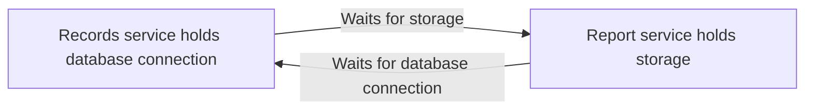

# Deadlock and Hospital Resource Allocation

The project demonstrates operating-system resource management using hospital software services. It checks a fixed snapshot rather than managing live hospital resources.

## The four necessary conditions

| Condition | Meaning | Hospital software example |
| --- | --- | --- |
| Mutual exclusion | At least one resource instance can be used by only one process at a time | A printer handles one print job at a time |
| Hold and wait | A process retains resources while requesting others | A report service holds a database connection while waiting for a printer |
| No preemption | Resources cannot be forcibly taken away | A service releases its allocation when its operation finishes |
| Circular wait | Processes form a cycle, each waiting for a resource held by the next | Records holds a database connection and waits for storage; reporting holds storage and waits for the connection |

All four conditions must hold for deadlock to occur. Breaking one prevents deadlock. Avoidance uses declared maximum demands to keep resource allocation safe.

This cycle illustrates the concept. The Java application receives matrices; it does not run concurrent hospital services or construct a live wait graph.

## The safety check

`Need = Maximum - Allocation`

1. Copy Available into Work and mark all processes unfinished.
2. Select an unfinished process whose Need is at most Work for every resource type.
3. Simulate completion by adding its Allocation to Work and marking it finished.
4. Continue until all processes finish or no unfinished process qualifies.

The resource-release step adds **Allocation**, rather than Need or Maximum. A completing process can first borrow its remaining Need and then return everything; the net increase in the free pool is its original Allocation.

| Result or condition | Meaning |
| --- | --- |
| Safe | At least one order lets every process complete, even if each needs its declared maximum |
| Unsafe | Such an order cannot be guaranteed from this snapshot |
| Deadlocked | Processes are actually waiting indefinitely for one another's held resources |

An unsafe snapshot does not alone prove deadlock: a process may later request less than its maximum. The program does not read current outstanding requests, so it reports UNSAFE rather than claiming confirmed deadlock.

The full Banker's resource-request procedure would tentatively allocate each request, run the safety check, and roll back an unsafe grant. The report and this repository implement the safety-check portion. Live requests and recovery remain future enhancements.

## Assumptions

- Maximum demands are declared in advance.
- Resources are reusable and released after completion.
- Available is consistent with total capacity; a separate total-capacity vector is not entered.
- Allocation and Available are non-negative; Maximum is no smaller than Allocation.
- Inputs represent one snapshot, without concurrent updates.

See the [source report](Hospital_Deadlock_Report_25BTRAD051.docx), [alignment table](REPORT_ALIGNMENT.md), and [project guide](../README.md).
